<div align="center">


<br>


<br><br>

[](https://diea.online)
[](https://airflow.diea.online)
[](https://www.linkedin.com/in/diea-abdeltwab/)
[](mailto:diea.abdeltwab@gmail.com)
[](https://leetcode.com/u/diea-abdeltwab/)

</div>

---

<div align="center">


</div>

## 🖥️ DevSetup & Tools

<div align="center">

[](https://go-skill-icons.vercel.app)

</div>

## 🛠️ Data Engineering Skills

<div align="center">

**Programming**<br>
   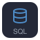 

**Concepts & Architecture**<br>
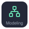 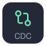  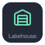

**Data Ingestion & Streaming**<br>
 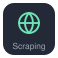 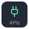

**Databases**<br>
 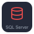  

**Data Lake, Warehousing & Lakehouse**<br>
   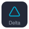

**Data Processing**<br>
  

**Workflow Orchestration & ETL**<br>
  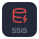

**Cloud**<br>
  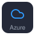 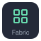

**Analytics & Visualization**<br>
 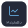 

**DevOps & Tools**<br>
    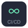 

</div>

---

<div align="center">

```text
$ git commit -m "keep building"
```


</div>
