<div align="center">


<br>

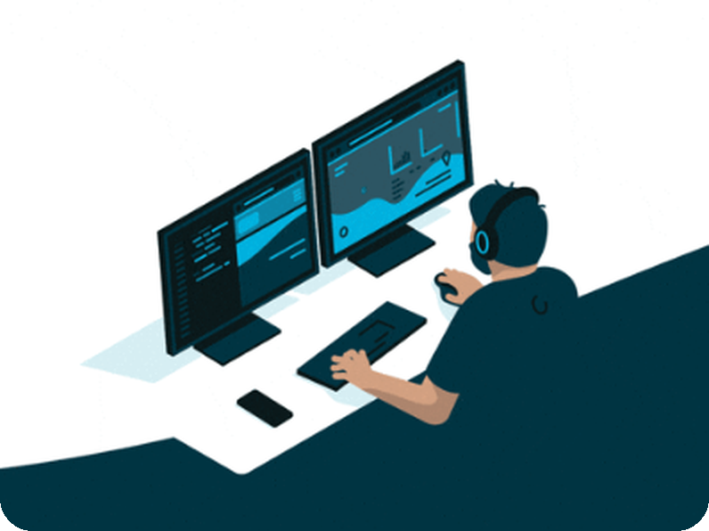

<br><br>

[](https://diea.online)
[](https://airflow.diea.online)
[](https://www.linkedin.com/in/diea-abdeltwab/)
[](mailto:diea.abdeltwab@gmail.com)
[](https://leetcode.com/u/diea-abdeltwab/)

</div>

---

<div align="center">


</div>

## 🖥️ DevSetup & Tools

<div align="center">

[](https://go-skill-icons.vercel.app)

</div>

## 🛠️ Data Engineering Skills

<div align="center">

<table>
<tr>
<td align="right" valign="middle"><b>Programming</b></td>
<td valign="middle">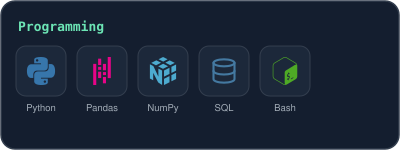</td>
</tr>
<tr>
<td align="right" valign="middle"><b>Concepts &amp; Architecture</b></td>
<td valign="middle">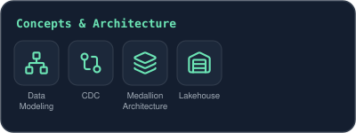</td>
</tr>
<tr>
<td align="right" valign="middle"><b>Data Ingestion &amp; Streaming</b></td>
<td valign="middle">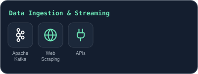</td>
</tr>
<tr>
<td align="right" valign="middle"><b>Databases</b></td>
<td valign="middle">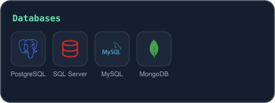</td>
</tr>
<tr>
<td align="right" valign="middle"><b>Data Lake, Warehousing &amp; Lakehouse</b></td>
<td valign="middle">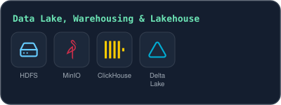</td>
</tr>
<tr>
<td align="right" valign="middle"><b>Data Processing</b></td>
<td valign="middle">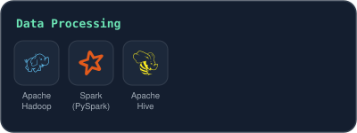</td>
</tr>
<tr>
<td align="right" valign="middle"><b>Workflow Orchestration &amp; ETL</b></td>
<td valign="middle">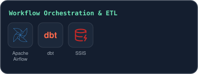</td>
</tr>
<tr>
<td align="right" valign="middle"><b>Cloud</b></td>
<td valign="middle">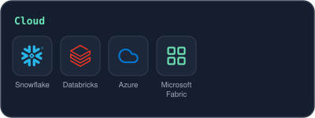</td>
</tr>
<tr>
<td align="right" valign="middle"><b>Analytics &amp; Visualization</b></td>
<td valign="middle">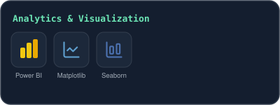</td>
</tr>
<tr>
<td align="right" valign="middle"><b>DevOps &amp; Tools</b></td>
<td valign="middle">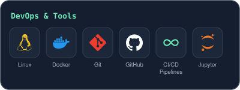</td>
</tr>
</table>

</div>

---

<div align="center">

```text
$ git commit -m "keep building"
```


</div>
